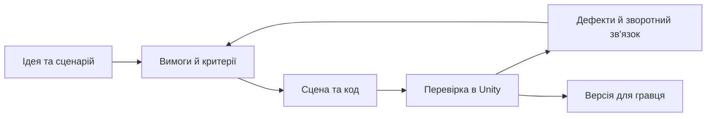

# Практична 3. Життєвий цикл розробки

**Мета.** Обрати процес для поступового розвитку одного продукту.

Для Ashrisen обрано **ітераційний цикл**. Бойові відчуття й планування рівня перевіряються тільки на робочому прототипі, тому зміни зручно вносити короткими ітераціями: вимога → реалізація → перевірка → виправлення. Стадії не ототожнюються з окремими історичними комітами: фактичний порядок попередньої роботи за одним зрізом репозиторію відновити не можна.

**Приклад ітерації.** Для церковної арени: визначити, що гравець не має застрягати; зробити суцільну підлогу та межі; прогнати перевірку руху, ривка й стрибка; переглянути результат. Збережений результат `Evidence/boss-arena-collision-results.txt` містить 10 успішних перевірок.

**Критерій переходу.** Наступна функція береться після того, як поточна запускається, має перевірювані критерії та не ламає базовий цикл гри. Формального журналу спринтів за минулі ітерації немає.
