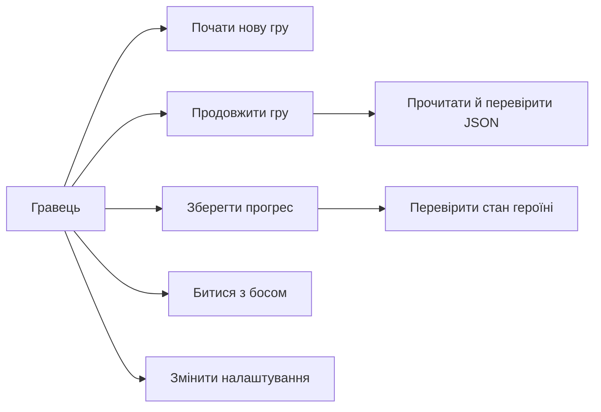

# Практична 6. Use Case модель

**Мета.** Показати дії користувача й детально описати три сценарії.

**UC1 — Продовжити гру.** Передумова: існує сумісний файл збереження. Гравець натискає «Продовжити», система читає JSON, перевіряє версію, дозволену сцену й позитивне здоров'я, завантажує сцену та відновлює позицію. Альтернатива: файла немає або він некоректний — повертається повідомлення про помилку, завантаження не відбувається. Код: `GameSaveSystem.TryRead`, `Continue`, `RestorePending`.

**UC2 — Зберегти прогрес.** Передумова: героїня жива й має `Rigidbody2D` та `AshHealth`. Система записує сцену, позицію, швидкість, чекпойнт, здоров'я, напрям і перемогу над босом. Альтернатива: немає персонажа або файловий запис заборонено — метод повертає помилку. Код: `GameSaveSystem.Save`.

**UC3 — Увійти на арену.** Передумова: гравець поряд із дверима й керування не заблоковане. Натискання `E` викликає `WorldDoor.TryUse`, завантажує цільову сцену і переносить героїню до точки прибуття. Якщо гравець далеко або потрібна перемога над босом не отримана, перехід відхиляється.
