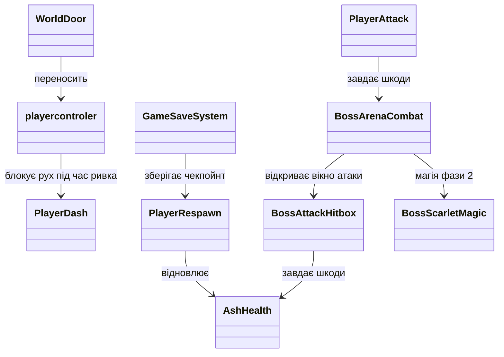

# Практична 7. Структура програми й класи

**Мета.** Визначити ключові класи, їх відповідальність і зв'язки.

**Поділ відповідальностей.** `playercontroler` керує переміщенням; `PlayerDash` — ривком; `PlayerAttack` — напрямом і часом удару; `AshHealth` — здоров'ям; `GameSaveSystem` — серіалізацією; `BossArenaCombat` — станами й фазами боса. Класи розміщено в `Assets/Scripts` і `Assets/AshHeartsHUD/Scripts`.

**Обмеження моделі.** Це оглядова діаграма, не автоматично згенерований повний UML усіх 88 C# файлів. Подальше розділення великого `BossArenaCombat` на менші компоненти може зменшити зв'язаність.
