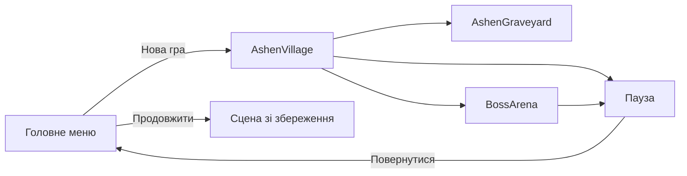

# Практична 8. Інтерфейс і навігація

**Мета.** Описати шлях гравця, ключові екрани й правила візуального оформлення.

**Екрани.** `MainMenu.unity` показує вибір гри; `PauseMenu.cs` відкриває сторінки паузи й налаштувань, дозволяє зберегти гру, змінити гучність, якість та повноекранний режим. У світі підказки взаємодії з дверима й ліхтарями показуються поряд із контекстом. `BossArena.unity` тримає персонажів і атаки видимими на темній церковній арені.

**Правила.** Яскраві акценти використовуються для керованого персонажа, ворогів, атаки та вибраного пункту меню. Фон не повинен зливатися з небезпечними об'єктами. Клавіша `E` запускає взаємодію біля дверей; інші керування перевіряються в ігровому вводі.

**Артефакт.** Реалізовані сцени й код замінюють статичний макет. Окремого підтвердженого Figma прототипу немає; цей пункт силабусу лишається відкритим.
