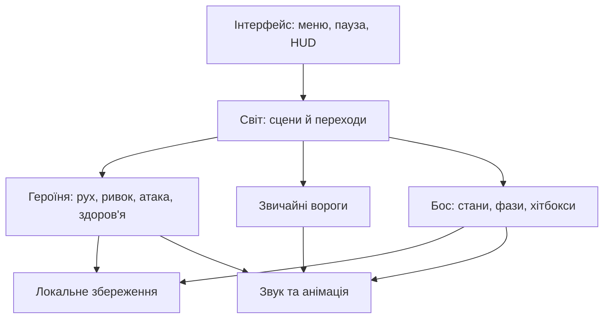

# Практична 11. Архітектура та модулі

**Мета.** Зрозуміти, як сцени й підсистеми утворюють одну гру.

**Сцени.** `MainMenu`, `AshenVillage`, `BossArena`, `AshenGraveyard` додані до `EditorBuildSettings.asset`. `WorldDoor` виконує локальні переходи; `SceneTransitionManager` координує затемнення та блокування вводу.

**Логіка.** Керування героїнею розділене між `playercontroler`, `PlayerDash`, `PlayerAttack` і `AshHealth`. Звичайні вороги реалізовані, зокрема, у `GothicEnemy` та `AshHound`. `BossArenaCombat` координує поведінку, `BossAttackHitbox` наносить контактну шкоду, `BossScarletMagic` обслуговує магію другої фази. `CombatAudio` і анімаційні компоненти відповідають за відгук.

**Дані.** `GameSaveSystem` записує один JSON файл у `Application.persistentDataPath`. Це локальна архітектура без сервера. Для розширення на кілька слотів треба окремо спроєктувати каталог, індекс і операції керування.
